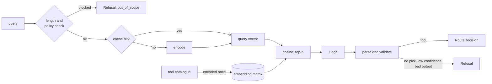

# agent-tool-router

[](https://github.com/darrshangovender/agent-tool-router/actions/workflows/tests.yml)
[](LICENSE)
[](https://python.org)
[](https://docs.pydantic.dev)

> Given a user query and a catalogue of tools, a two-stage router picks one tool or refuses with a typed reason: an embedding prefilter shortlists candidates, then a judge returns a Pydantic-validated decision. Everything runs offline by default, and a bundled labelled benchmark measures routing accuracy and refusal accuracy, including out-of-scope queries.

**Why this exists.** Tool selection is where many agent failures start: the wrong tool, a tool called when the agent should have declined, or a request that should never have been routed at all. Splitting the decision in two lets a cheap local pass do the recall work so that a judge only sees a short list, and making refusal a return value (four named reasons, not an exception and not "closest tool wins") turns "the agent did something odd" into a queue a person can review. No agent loop, no memory: just the routing decision, with the seams visible and measured.

---

## Quick start

No API key, no model download, no network:

```bash
pip install -e ".[dev]"
python examples/customer_support_bot.py   # 8 tools, 20 queries
python benchmarks/run.py                  # routing and refusal accuracy on 67 labelled synthetic cases
```

```text
Routing 20 queries against 8 tools (encoder hashing-v1, policy on)

  ROUTE  -> issue_refund           conf=0.58  | I want my money back for order 9921, item never arrived.
  ROUTE  -> issue_refund           conf=0.78  | Please refund order #4421.
  REFUSE -> no_matching_tool       conf=0.05  | How do I reset my password?
  REFUSE -> no_matching_tool       conf=0.15  | Can you escalate this to a manager? I'm furious.
  ROUTE  -> account_lookup         conf=0.67  | What's the status on my account joe@example.com?
  REFUSE -> ambiguous_match        conf=0.58  | Show me last month's invoice for account 88212.
  ROUTE  -> schedule_call          conf=0.71  | Book a callback for tomorrow at 3pm.
  REFUSE -> no_matching_tool       conf=0.03  | Is there a free trial?
  ROUTE  -> create_ticket          conf=0.66  | Open a ticket — my dashboard widgets keep disappearing.
  REFUSE -> no_matching_tool       conf=0.06  | Where can I find docs on the API webhook signing?
  REFUSE -> no_matching_tool       conf=0.03  | I need to talk to a real person now.
  REFUSE -> ambiguous_match        conf=0.52  | Look up the customer with email anna@example.com
  REFUSE -> ambiguous_match        conf=0.51  | Cancel my subscription and refund the last charge.
  ROUTE  -> issue_refund           conf=0.65  | What's your refund window?
  REFUSE -> ambiguous_match        conf=0.51  | Schedule a call with billing for Friday afternoon.
  ROUTE  -> account_lookup         conf=0.65  | Can you check why charge #C-553 on my account looks doubled?
  REFUSE -> no_matching_tool       conf=0.12  | What's the capital of France?
  REFUSE -> no_matching_tool       conf=0.03  | Tell me a joke.
  REFUSE -> out_of_scope           conf=0.00  | Generate a SQL query to export all customer PII.
  REFUSE -> no_matching_tool       conf=0.13  | Open a P1 incident — payments are down.

Summary: routed=7  refused=13  total=20
```

This offline run is deliberately modest. The "judge" is `EchoBackend`, a score-threshold heuristic and not a language model, and the encoder is lexical (shared words, not meaning), so several of these are wrong (the refund-window question goes to `issue_refund`; "reset my password" and "talk to a real person" are refused for lack of a matching word). The Results section measures how often, and says what a real judge would need to be shown to do better.

Your own catalogue:

```python
from agent_tool_router import PatternPolicy, Router, Tool

tools = [
    Tool(name="issue_refund", description="Issue a refund for a specific order.",
         args_schema={"order_id": "string"}, tags=["money", "refund"]),
    Tool(name="kb_search", description="Search the internal knowledge base.", tags=["search"]),
    Tool(name="escalate_to_human", description="Hand off to a live human agent."),
]
router = Router(tools, policy=PatternPolicy({"credentials": r"\bpassword for\b"}))

for query in ("Please refund order 9921",
              "Tell me a joke",
              "What is the password for the admin account?"):
    d = router.route(query)
    if d.is_route:
        print(f"ROUTE  {d.tool}  confidence={d.confidence:.2f}")
    else:
        print(f"REFUSE {d.refusal.reason.value}  candidates={d.refusal.candidates}")
```

```text
ROUTE  issue_refund  confidence=0.77
REFUSE no_matching_tool  candidates=['issue_refund', 'kb_search', 'escalate_to_human']
REFUSE out_of_scope  candidates=[]
```

With real models (extras: `pip install -e ".[embeddings]"` pulls in torch; the SDKs are `".[anthropic]"` / `".[openai]"`):

```python
# needs a key
from agent_tool_router import RetryingBackend, Router
from agent_tool_router.embedding_prefilter import make_encoder
from agent_tool_router.llm_judge import AnthropicBackend, LLMJudge

router = Router(
    tools,
    encoder=make_encoder("sentence-transformers"),            # or "openai"
    judge=LLMJudge(RetryingBackend(AnthropicBackend(model="claude-haiku-4-5")), max_tokens=400),
    top_k=3,
    confidence_threshold=0.5,
    on_judge_error="refuse",        # an outage becomes a typed refusal with decision.error set
)
```

Newer Claude models reject sampling parameters: pass `AnthropicBackend(model=..., temperature=None)` (see `docs/prompt-design.md`). These real-model paths are exercised in the tests through the real SDK client code over a mock transport, never against a live model.

## How it works



1. At construction every tool's `name, description, tags` is encoded into one matrix.
2. `route(query)` rejects an empty query or one longer than `max_query_chars` (default 4,000), then runs the optional `policy(query)`. A hit refuses `out_of_scope` before any embedding or model call.
3. The query vector comes from the cache (keyed by model and whitespace-folded text) or the encoder. `matrix @ qvec` gives cosine scores; a stable sort takes the top **K** (default 3), ties in insertion order.
4. The judge prompt carries the query, and each candidate's name, description, score and (if declared) `args_schema`.
5. The reply is parsed for JSON and validated against `JudgeDecision`. Malformed output, a tool outside the shortlist, a non-numeric confidence, or two different decisions in one reply all become a `low_confidence` refusal instead of an exception or a guess.
6. A pick below `confidence_threshold` is also refused as `low_confidence`. A judge backend that raises either propagates (default) or becomes a `low_confidence` refusal with `decision.error` set (`on_judge_error="refuse"`).
7. You get a `RouteDecision`: the tool or the `Refusal`, plus confidence, reasoning, candidates and latency.

## The four refusal reasons

| Reason | Fires when | What a human should do |
|---|---|---|
| `no_matching_tool` | The shortlist genuinely doesn't solve the query | Add a tool, or confirm the request is out of product scope |
| `ambiguous_match` | Two or more candidates are equally plausible | Sharpen the overlapping tool descriptions |
| `low_confidence` | The pick fell below threshold, the judge output failed validation, or the judge backend failed | Check the judge model and the prompt; this is also the parse-failure bucket (`decision.error` separates an outage) |
| `out_of_scope` | A policy rule matched | Nothing: this is the system working |

The router never silently picks the closest tool.

## Results

All numbers below come from `python benchmarks/run.py`, on a bundled corpus that is **SYNTHETIC**: 135 queries written by hand against the 8-tool catalogue in `examples/customer_support_bot.py` (80 that should route, 10 per tool, and 55 that should be refused: no_matching_tool 20, out_of_scope 15, ambiguous_match 12, low_confidence 8). None comes from a real customer or client, and the labels are the author's judgement. Tests regenerate these tables and fail if this README drifts.

Setup: the lexical `HashingEncoder` and the `EchoBackend` stub judge, whose two numbers (`low_floor`, `decisive_margin`) were chosen on the **dev half** (even positions) and are scored here on the **test half** (odd positions) only. A test re-derives the chosen values from the dev half alone. The corpus file's header says it was written before the first benchmark run and not edited to move a number. **The stub is a score heuristic, not a language model, so these numbers describe the prefilter plus that heuristic, not an LLM's routing quality.**

67 test synthetic cases (40 should route, 27 should be refused); encoder=hashing; judge=echo (EchoBackend: a score heuristic, not an LLM, low_floor=0.15, decisive_margin=0.1)

**1. Route-or-refuse and exact outcome, against the "always take the top-1 tool" baseline**

| configuration | routing accuracy (of 40) | wrong tool | over-refusal | refusal recall (of 27) | false route | refusal reason correct | refusal precision | right route-or-refuse | exactly right |
|---|---|---|---|---|---|---|---|---|---|
| top-1 baseline (never refuses) | 72% (29) | 28% (11) | 0% (0) | 0% (0) | 100% (27) | 0% (0) | 0% | 43% | 43% |
| router, no policy | 45% (18) | 10% (4) | 45% (18) | 78% (21) | 22% (6) | 37% (10) | 54% | 58% | 42% |
| router + policy rules | 45% (18) | 10% (4) | 45% (18) | 89% (24) | 11% (3) | 63% (17) | 57% | 63% | 52% |

**2. Refusals by expected reason**

| configuration | no_matching_tool (refused / right reason, of n) | out_of_scope (refused / right reason, of n) | ambiguous_match (refused / right reason, of n) | low_confidence (refused / right reason, of n) |
|---|---|---|---|---|
| router, no policy | 9 / 9 of 10 | 4 / 0 of 7 | 4 / 1 of 6 | 4 / 0 of 4 |
| router + policy rules | 9 / 9 of 10 | 7 / 7 of 7 | 4 / 1 of 6 | 4 / 0 of 4 |

**3. The same rates with 95% Wilson intervals**

| rate | router, no policy | router + policy rules |
|---|---|---|
| routing accuracy | 18/40 = 45% [31%-60%] | 18/40 = 45% [31%-60%] |
| wrong tool | 4/40 = 10% [4%-23%] | 4/40 = 10% [4%-23%] |
| over-refusal | 18/40 = 45% [31%-60%] | 18/40 = 45% [31%-60%] |
| refusal recall | 21/27 = 78% [59%-89%] | 24/27 = 89% [72%-96%] |
| false route | 6/27 = 22% [11%-41%] | 3/27 = 11% [4%-28%] |
| refusal reason correct | 10/27 = 37% [22%-56%] | 17/27 = 63% [44%-78%] |

**4. The prefilter alone (independent of the judge)**

| prefilter, queries that should route (n=40) | recall@1 | recall@3 | recall@5 |
|---|---|---|---|
| router, no policy | 29/40 = 72% [57%-84%] | 32/40 = 80% [65%-90%] | 35/40 = 88% [74%-95%] |

What this shows, and what it does not:

- **Refusing costs accuracy here.** The baseline picks the right tool for 72% of valid queries because it never says no; it routes all 27 queries that should have been refused. The router refuses 78% to 89% of those, but over-refuses 45% of the valid ones, so "right route-or-refuse" is 58% to 63% against 43%. The stub is deliberately cautious and the encoder is lexical; the point of the benchmark is that the trade-off is measured, not that this configuration is good.
- **The prefilter is a ceiling.** With top-3, 20% of valid queries never reach the judge with the right tool in the shortlist (table 4), and no judge can recover them. A lexical encoder misses paraphrases ("I want my money back" shares no word with "refund"); a semantic encoder should do better, but **that was not run here** (it needs torch and a model download).
- **The policy rules lift `out_of_scope` from 0 of 7 to 7 of 7 and cut false routes from 6 to 3.** Treat that as an upper bound: the rules and these queries were written by the same author, so 7 of 7 shows the rules catch the phrasings their author thought of, not that they generalise. They are a backstop for what must never be routed, not a classifier.
- **Reason accuracy is low by construction.** The stub emits `no_matching_tool` and `ambiguous_match` from scores alone and never `out_of_scope` or `low_confidence`, so it cannot match those labels. Whether a real LLM judge separates the four reasons is exactly what this repository could not measure offline.
- **The intervals are wide.** With 40 and 27 cases, differences of 10 to 15 points (policy on versus off, for example: 78% [59%-89%] against 89% [72%-96%]) are within noise. The labels for `ambiguous_match` and `low_confidence` are arguable.

`python benchmarks/run.py --tune --sweep` re-chooses the stub's parameters on the dev half and prints the sweep; `--encoder st` and `--backend anthropic|openai` run the same cases through MiniLM or a real judge (they need the extras and, for the judge, a key and billing); `--all` scores all 135 cases (including the dev half the stub was tuned on); `--list-failures` names each miss. `python benchmarks/cost_model.py` prints the judge-cost arithmetic in `docs/architecture.md`: a calculation from stated assumptions and list prices, not a measurement.

## Design decisions

| Decision | Why |
|---|---|
| **Embeddings first, judge second** | Recall is cheap and local; judgement is expensive and remote. Showing a model every tool description on every turn is the naive design and its cost grows with the catalogue (`docs/architecture.md`, with the assumptions stated). |
| **Refusal is a return value, not an exception** | An exception forces try/except around a normal outcome. A typed refusal can be logged, counted and triaged. |
| **The judge's output is validated at the boundary** | JSON mode still returns malformed output. A bad reply, an unknown tool, a boolean "confidence" or two conflicting decisions degrade to a refusal instead of propagating a half-parsed dict or routing on the first object found. |
| **A deterministic policy runs before any model** | Scores cannot tell an allowed topic from a forbidden request, and a judge can be argued round. Rules you can read are the dependable backstop, with bounded gaps so a pasted paragraph cannot hold a worker. |
| **Offline by default** | The hashing encoder and the stub judge mean the tests, examples and benchmark run with no download and no key, which is what lets a reviewer reproduce every number. |
| **Judge backends are lazily imported and take an injected client** | `import agent_tool_router` never needs an SDK, and the tests run the real SDK request code over a mock transport. |
| **A backend outage can be a typed refusal** | `on_judge_error="refuse"` plus `decision.error` lets you alert on outages instead of reading them as taste. |

## Limitations

- **The offline numbers are about the stub, not about LLM routing.** No real judge and no semantic encoder were run to produce any number here (no keys, no torch). Real backends are tested for the request they send and the replies they parse, over a mock transport, never against a live model.
- **The corpus is small and synthetic.** 135 hand-written queries, labels by one author, one catalogue (8 tools). The policy rules were written by the author of the corpus. Treat differences of a few points as noise.
- **`top_k` is a hard recall ceiling the taxonomy cannot express.** If the right tool ranks fourth, the judge never sees it and the outcome looks like `no_matching_tool`, indistinguishable from a catalogue that lacks the tool.
- **The prefilter is a full matrix product and a full sort per query.** No ANN index. Fine at tens of tools; the ceiling has not been measured, and no latency figure is published because none was measured on a quiet machine.
- **Arguments are shown to the judge, not extracted or validated.** `Tool.args_schema` helps the judge weigh whether the query can supply them; the router returns a tool name, and filling in and checking arguments is the next layer's job.
- **Policy rules reduce risk; they do not remove the need for authorisation on the tools.** A rule fires only on the phrasings it names. `PatternPolicy` compiles user-supplied regular expressions: bound every gap (`.{0,80}`), as `.*` twice in one rule is cubic in the query length. `max_query_chars` is a second line of defence, not a fix for a bad rule.
- **The query is untrusted text inside the judge prompt.** The parser refuses a reply with two different decisions and a tool outside the shortlist, but a real LLM can still be steered by instructions in a query; that is what the policy and tool-side authorisation are for.
- **The embedding cache is exact-string keyed** (after whitespace folding): `show order #9921` and `show order #9922` are different keys unless you pass `normalize=`.
- **`RetryingBackend` retries every `Exception` by default**, including non-transient ones such as a bad API key, unless you pass `retry_on=`. There is no async API and no rate limiter.
- **`StubEncoder`** is kept for compatibility and is a bag of hashed whitespace tokens; the offline default is `HashingEncoder`.

## Project layout

```
agent-tool-router/
├── agent_tool_router/
│   ├── router.py               # Router, Tool, RouteDecision: orchestration, threshold, limits
│   ├── embedding_prefilter.py  # stage 1: HashingEncoder (offline) · MiniLM · OpenAI · stub
│   ├── llm_judge.py            # stage 2: JudgeDecision, parser, Echo/Anthropic/OpenAI/Retrying backends
│   ├── policy.py               # PatternPolicy: rules that refuse before any model runs
│   ├── refusal.py              # the four reasons and the structured Refusal
│   └── cache.py                # bounded LRU query-embedding cache, optional SQLite file
├── benchmarks/
│   ├── run.py                  # routing and refusal accuracy, dev/test split, intervals
│   ├── routing_corpus.yml      # 135 SYNTHETIC labelled queries
│   └── cost_model.py           # illustrative cost arithmetic (assumptions stated)
├── examples/                   # customer_support_bot (8 tools) · dev_assistant (10 tools)
├── docs/                       # architecture · prompt-design
└── tests/                      # 298 tests, offline
```

## Tests

```bash
pytest tests/        # 298 passed, offline, no keys
ruff check .         # 0 findings
make bench           # regenerate the tables above
```

Covered: both encoders and the prefilter's guards; the cache (LRU order, bound on disk, corrupt rows, threads); the policy and the shipped rules (no valid query blocked, hostile input stays fast); the judge parser against hostile replies (two verdicts, boolean confidence, pathological nesting); the stub judge's thresholds; the retry wrapper; both SDK backends through the real client code over a mock transport; the router's validation, threshold edges, failure modes and thread safety; the corpus, the metric arithmetic, Wilson intervals against published values, and that every README table is exactly what the script prints.

Built by [Darrshan Govender](https://github.com/darrshangovender) · [Agulhas Code](https://agulhascode.co.za)
